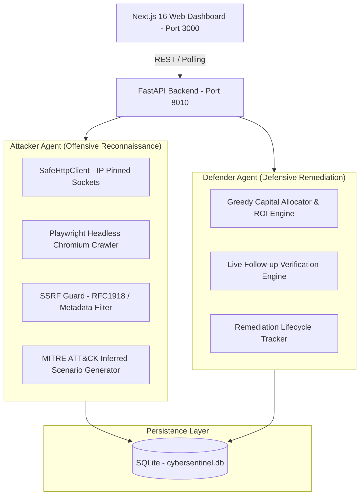

# CyberSentinal AI — Web Security Assessment & Remediation Platform

CyberSentinal AI is an evidence-grounded website security assessment, threat modeling, and ROI-driven remediation budgeting platform. It features paired **Attacker** and **Defender** autonomous agents that validate vulnerabilities, calculate financial loss exposure using the FAIR quantitative risk model, and prioritize security fixes according to real-world capital constraints.

---

## Architecture Overview



---

## Prerequisites

1. **Node.js**: v18.17+ or v20+ (`node -v`)
2. **Python**: v3.11 or v3.12 (`python --version`)
3. **Playwright Chromium**: Browser binaries installed for Python

---

## Quick Start (Clean Checkout)

### 1. Backend Setup

Open a terminal in the project root:

```bash
# Navigate to backend directory
cd backend

# Create Python virtual environment
python -m venv .venv

# Activate virtual environment
# Windows (PowerShell):
.\.venv\Scripts\Activate.ps1
# Linux / macOS:
source .venv/bin/activate

# Install Python dependencies
pip install -r requirements.txt

# Install Playwright browser binaries
playwright install chromium

# Launch the FastAPI backend server (Port 8010)
python -m uvicorn app.main:app --reload --host 127.0.0.1 --port 8010
```

Verify backend health:
```bash
curl http://127.0.0.1:8010/health
# {"status":"healthy","app":"CyberSentinal API","version":"1.0.0","database":"healthy","mode":"standalone-server"}
```

### 2. Frontend Setup

Open a second terminal in the project root:

```bash
# Install Node.js dependencies
npm install

# (Optional) Verify backend URL in environment:
# Default connects to http://127.0.0.1:8010
# Set NEXT_PUBLIC_API_URL in .env.local if running on a custom port.

# Launch Next.js development server (Port 3000)
npm run dev
```

Open your browser at **[http://localhost:3000](http://localhost:3000)**.

---

## Running Verification & Tests

### Backend Pytest Suite
```bash
cd backend
.\.venv\Scripts\python.exe -m pytest tests/
```
*Expected: 108 passed tests covering SSRF guards, socket IP pinning, Playwright browser network isolation, FAIR loss modeling, and Defender verification.*

### Frontend TypeScript Check
```bash
npx tsc --noEmit
```

### Frontend Production Build
```bash
npm run build
```

---

## Safe Demonstration Workflow (Hackathon Walkthrough)

To present the full Attacker → Defender → Remediation → Verification sequence safely:

1. **Navigate to the Agents Tab:**
   - In the sidebar navigation, select **Agents**.
2. **Configure an Authorized Target:**
   - In the Attacker Agent input box, enter a public authorized website (e.g., `https://example.com`) or a configured local development target.
   - **Notice:** Checking the **"I confirm I am authorized to scan this target"** checkbox is mandatory. The backend rejects unverified scan requests with HTTP 403.
3. **Trigger Assessment (Single-Page or Full-Site Crawl):**
   - Click **"Run Security Assessment"** or **"Start Full-Site Crawl"**.
   - Observe real-time progress metrics (pages indexed, visited, requests completed, elapsed time).
4. **Inspect Evidence-Backed Findings:**
   - Review discovered findings (e.g., Missing CSP, Missing HSTS, Missing X-Frame-Options).
   - Click a finding card to expand the raw observed HTTP response headers, final status code, and target IP address. Notice that intermediary proxy errors (502/503/504) are never fabricated into missing-header findings.
5. **Generate Defender Remediation Plan:**
   - In the Defender Agent section, click **"Analyze & Allocate Budget"**.
   - Adjust the **Available Budget ($)** and **Hourly Rate ($/hr)**.
   - Observe how the greedy optimizer prioritizes fixes into three distinct categories:
     - **Fix Immediately (High ROI within budget)**
     - **Fix Next (Secondary priorities)**
     - **Defer or Mitigate (Excess items or low risk-reduction return)**
6. **Track Remediation Status:**
   - Transition a finding from `Open` / `Discovered` → `In Review` → `Fix Applied`.
   - Review the persisted transition audit trail in the status history table.
7. **Perform Follow-up Verification:**
   - Click **"Verify Fix"**.
   - The scanner executes a non-destructive follow-up check:
     - If the target now serves the required header/control, status changes to **Verified Fixed** with verification timestamp.
     - If the vulnerability remains present or the check is inconclusive, the fix is rejected and remains in its previous state.

---

## Security Architecture & Boundaries

### 1. Implemented Security Controls
- **SSRF & Network Boundary Protection:** Rejects RFC 1918 private subnets (`10.0.0.0/8`, `172.16.0.0/12`, `192.168.0.0/16`), loopback (`127.0.0.0/8`, `::1`), link-local, carrier-grade NAT, and cloud metadata (`169.254.169.254`).
- **Socket IP Pinning:** Resolves target IP addresses upfront, screens all resolved addresses, and directly connects raw TCP sockets to the screened IP before upgrading with TLS SNI hostname verification. This mitigates DNS rebinding / TOCTOU windows.
- **Chromium Browser Network Hardening:**
  - Pinned IP host rules (`--host-rules="MAP target.com <ip>, MAP * ~NOTFOUND"`).
  - Disabled WebRTC (`--disable-webrtc`) to prevent STUN/TURN UDP leaks.
  - Native service worker blocking (`service_workers="block"`).
  - Suppression of unexpected child windows (`popup.close()`), download cancellation (`download.cancel()`), and cross-origin WebSocket blocking.
  - Preserved strict TLS certificate validation (`ignore_https_errors=False`).
- **Server Restart Resilience:** Stranded scans in `running` or `queued` status automatically transition to `failed` upon startup, preventing zombie jobs.

### 2. Current Architecture vs. Production Specification
- **Single-Tenant Local Model:** CyberSentinal currently operates as a local, single-tenant assessment workbench stored in a local SQLite database (`cybersentinel.db`). User accounts, multi-tenant RBAC, and per-user login boundaries are not implemented and remain out of scope.
- **Browser Execution Environment:**
  - *Current (Development / Hackathon):* Chromium runs as a local child process with application-level route interception, host rules, and event listeners.
  - *Production Specification:* In high-assurance production environments, browser execution must run inside an isolated Linux container (e.g. gVisor / MicroVM) with kernel-level packet egress rules (`nftables` / `iptables`) permitting traffic strictly to the validated target IP on ports 80/443.

---

## Troubleshooting Guide

| Issue | Cause | Solution |
| :--- | :--- | :--- |
| **Port 8010 already in use** | A previous uvicorn server instance is running. | Run `netstat -ano \| findstr :8010` on Windows, identify the PID, and kill it with `taskkill /PID <PID> /F`, or start uvicorn on another port with `--port 8011` and update `NEXT_PUBLIC_API_URL` in `.env.local`. |
| **Port 3000 already in use** | Next.js server running in another terminal. | Next.js will automatically prompt to use port 3001, or stop the existing node process. |
| **SSRF error when scanning localhost** | SSRF Guard prohibits scanning loopback/internal hosts by default. | Enable development opt-in mode: set `ALLOW_LOCAL_DEV_SCAN=true`, `CYBERSENTINEL_ENV=development`, and `LOCAL_DEV_TARGET=http://localhost:4000` in the backend environment. |
| **Playwright browser missing** | Chromium binary not downloaded. | Run `playwright install chromium` inside the active Python virtual environment. |
| **Missing database file** | `cybersentinel.db` has not been initialized. | SQLite initializes automatically on first backend import. If corrupted, remove `cybersentinel.db`; the backend will recreate tables cleanly on restart. |
